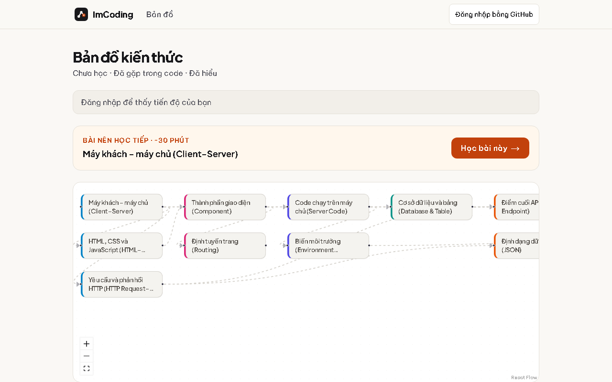
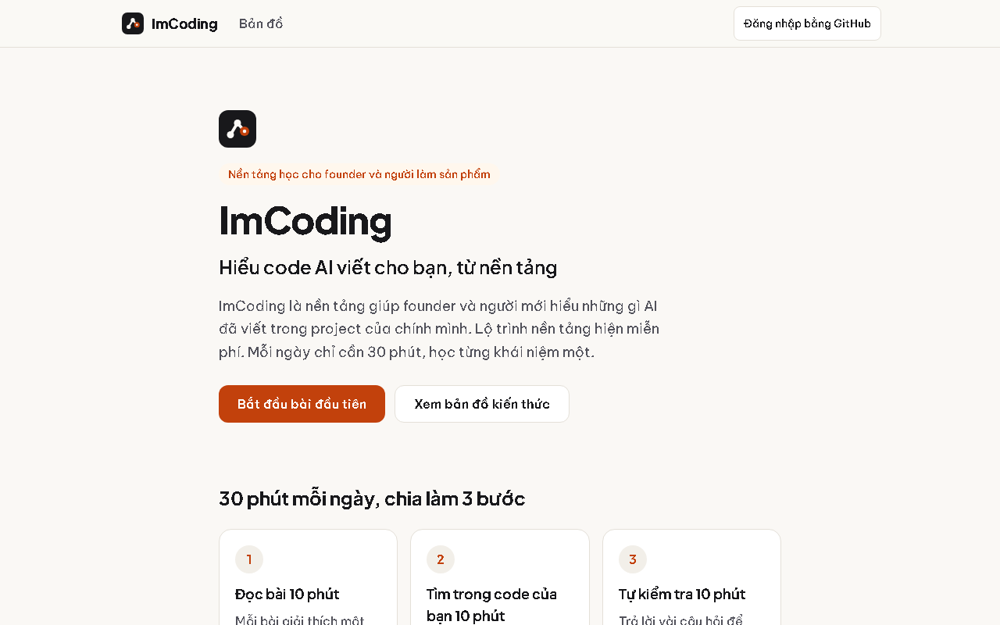

# ImCoding

**Understand the code AI writes for you, from the fundamentals.**

ImCoding is a learning platform for founders and non-developers who build products with AI coding assistants. Instead of generic programming courses, it teaches the core concepts (client–server, APIs, databases, secrets, deployment…) and asks you to find each one in **your own project**, 30 minutes a day.

**Live:** https://imcoding.dev · **Contact:** hello@imcoding.dev



## Why

AI tools make it easy to ship an app you don't understand. That gap becomes a problem the first time something breaks, a key leaks, or a change has to be reviewed. ImCoding closes the gap one concept at a time:

Each lesson takes around 30 minutes and includes:

1. **Recall:** bring back what you learned in the previous lesson.
2. **Predict:** try to solve a short incident before seeing the explanation.
3. **Worked example:** read an annotated code example.
4. **Find it in your own code:** locate the concept in your project.
5. **Explain why:** answer in your own words before opening the sample answer.
6. **Quizzes:** check your answers and read the explanations.
7. **Check yourself without AI:** solve a new situation on your own.
8. **Common reasoning mistakes:** review where your reasoning can go wrong.

Most lessons also include **hands-on exercises**, taking another 10–15 minutes in your own project. Recall appears in lessons with prerequisites.

Each step is based on learning research: retrieval practice, self-explanation, feedback.

## Features

- **Knowledge map:** 50 lessons linked by prerequisites, with a suggested next lesson that prioritizes earlier stages.
- Four risk-based stages (before letting AI edit code, before accepting AI-written features, before real users, operations) with advisory warnings, never locks.
- **Progress tracking:** sign in with GitHub, mark each concept as "seen in my code" or "understood".
- **Resume where you left off:** return to your current lesson step, saved to your account when signed in or to your browser otherwise.
- **Practical Q&A ([/hoi](https://imcoding.dev/hoi)):** search lessons without AI; get AI answers with your own Gemini key.
- **Ask AI about a lesson:** questions go straight from your browser to Google Gemini with your own API key (BYOK). Your Gemini key stays in your browser.
- **Privacy:** see the [privacy policy](https://imcoding.dev/privacy) for data storage and controls.



## Tech stack

Next.js 16 (App Router) · React 19 · TypeScript · Tailwind CSS 4 · Supabase (Postgres, Auth, RLS) · React Flow · Vitest · Playwright · Vercel

## Roadmap

See the [open issues](https://github.com/imcodingdev/imcoding/issues). Next up: a "reading code" track, spaced review, an English version of the lessons, and OpenAI as a second provider in Ask AI.

## Run locally

```bash
npm install
npm run dev        # http://localhost:3000
npm test           # unit tests (Vitest)
npm run e2e        # end-to-end tests (Playwright, port 3100)
```

Lessons live in `content/concepts/*.md`.

## Credits / Ghi nguồn

Five lessons on working with coding agents draw on [Learn Harness Engineering](https://github.com/walkinglabs/learn-harness-engineering) by WalkingLab (MIT).

Năm bài về làm việc với coding agent được viết dựa trên Learn Harness Engineering của WalkingLab (MIT), với liên kết tới từng bài giảng gốc ở cuối bài.

## License

MIT. See [LICENSE](LICENSE).

---

## Tiếng Việt

ImCoding là nền tảng học giúp founder và người mới hiểu những gì AI đã viết trong project của chính mình. Mỗi ngày 30 phút, học từng khái niệm một.

Lộ trình gồm 50 bài trong 4 chặng theo rủi ro (trước khi giao AI sửa code, trước khi nhận tính năng AI viết, trước khi mở app cho người dùng thật, khi vận hành), chỉ cảnh báo khuyến nghị và không khóa bài. Mỗi bài khoảng 30 phút gồm: nhắc lại (nếu có bài cần học trước), đoán trước, xem ví dụ có chú thích, tìm trong code của bạn, tự giải thích vì sao, Trắc nghiệm, kiểm tra không dùng AI và xem lỗi suy luận thường gặp. Đa số bài có thêm Bài tập thực hành trong 10–15 phút.

- **Học tiếp chỗ đang dở:** quay lại bước đang học, lưu theo tài khoản khi đăng nhập hoặc trên trình duyệt khi chưa đăng nhập.
- **Hỏi thực chiến ([/hoi](https://imcoding.dev/hoi)):** tìm bài không dùng AI; hỏi AI bằng Gemini key của chính người học.

- Trang chạy thật: https://imcoding.dev
- Liên hệ: hello@imcoding.dev
- Bài học nằm trong `content/concepts/*.md`. Cách chạy trên máy xem mục "Run locally" ở trên.
